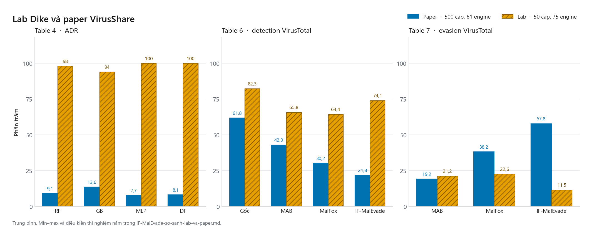

# IF-MalEvade — tái hiện paper

Tái hiện **IF-MalEvade** (Arif et al., IEEE Access 2023, DOI `10.1109/ACCESS.2023.3334645`).

Hai giai đoạn paper: MalGAN lọc influential import/section (3523 bit) → DQN 7 action, MAXTURN 50, γ=0.98, reward Eq. (1) → RF / GB / MLP / DT ngưỡng 0.8 → adversarial retrain 50% → Cuckoo so `signatures`.

```powershell
cd C:\Users\tuonghk\CDPLMD
python -m pip install -r requirements.txt
python run_experiment.py
```

Hyperparameter: GAN 100 epoch, DQN 500 episode, eval 500, test 1000 malware / 0 benign (Table 2).

## So sánh lab và paper

Lần chạy đã chốt dùng corpus Dike (50 cặp, 75 engine VirusTotal). Paper dùng VirusShare (500 cặp, 61 engine). Hai cột không gộp.



Bảng đủ min–max, ADR local và 41/50 cặp Cuckoo: [IF-MalEvade-so-sanh-lab-va-paper.md](IF-MalEvade-so-sanh-lab-va-paper.md). Số trên hình là trung bình, lấy từ `results/dike2500/summary.json` và `results/dike2500/baselines.json`. Vẽ lại bằng `python scripts/plot_lab_vs_paper.py`.

Kết quả: `results/summary.json`, `table4_ml_detectors.csv`, `table5_adversarial_retrain.csv`.

Table 6–7 (VirusTotal, N=61): cần `VT_API_KEY` (hoặc `data/vt.api`). Mẫu gốc = hash lookup SHA-256, không upload binary. Mẫu mutate = upload PE khi có file trong `data/pe/malware/`.

```powershell
$env:VT_API_KEY = "<key>"
python scripts/vt_table67.py --eval-n 500
```

## Ánh xạ paper → code

| Paper | Code |
|-------|------|
| 3269 import + 254 section = 3523 | `Config.n_features` |
| §E MalGAN, chỉ thêm feature (OR) | `if_malevade/malgan.py` |
| §F DQN, hidden 256×64, ReLU, γ=0.98 | `if_malevade/dqn.py` |
| Eq. (1) | `if_malevade/env.py` `success_reward` |
| Table 3 — 7 action | `ACTIONS` trong `env.py` / `pe_mutate.py` |
| Eq. (2) DQN TD loss | `DQNAgent.learn` |
| Table 4 ODR/ADR/AUC | `results/table4_ml_detectors.csv` |
| Table 5 retraining 50% | `results/table5_adversarial_retrain.csv` |
| Cuckoo signatures | `if_malevade/cuckoo_client.py` |

## Dữ liệu

`data/paper25k/malware_raw.jsonl` (25k) + `benign_raw.jsonl` (10k) → `dataset.npz` 3523 chiều.

Rebuild npz:

```powershell
python -c "from pathlib import Path; from if_malevade.data import write_paper_dataset; print(write_paper_dataset(Path('data/paper25k/malware_raw.jsonl'), Path('data/paper25k/benign_raw.jsonl'), Path('data/paper25k')))"
```

## Cuckoo

Paper so **Cuckoo signatures** gốc vs mutate. Cuckoo 3 trên Ubuntu 22.04 WSL2. Token: `data/cuckoo/api.token`. Không gửi VirusTotal. Không phát tán PE ra ngoài lab.
